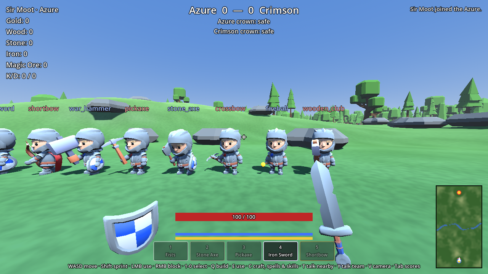
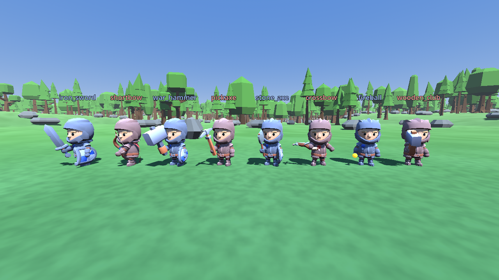
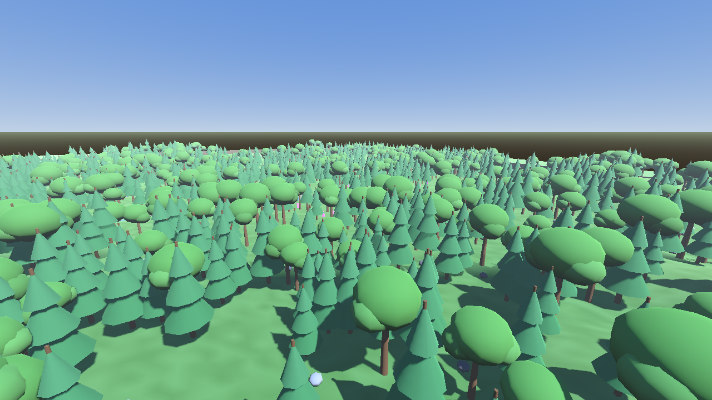
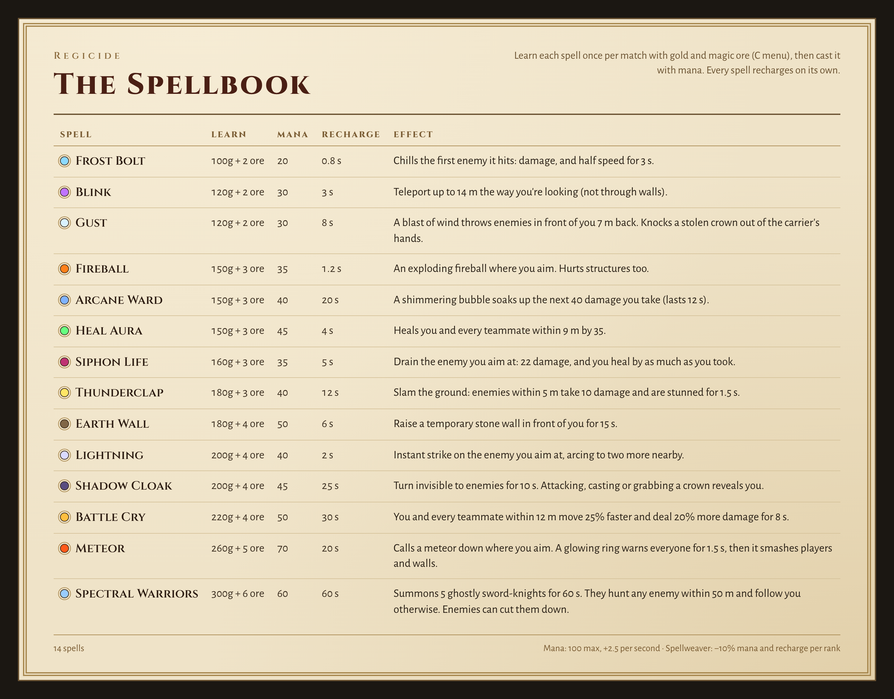
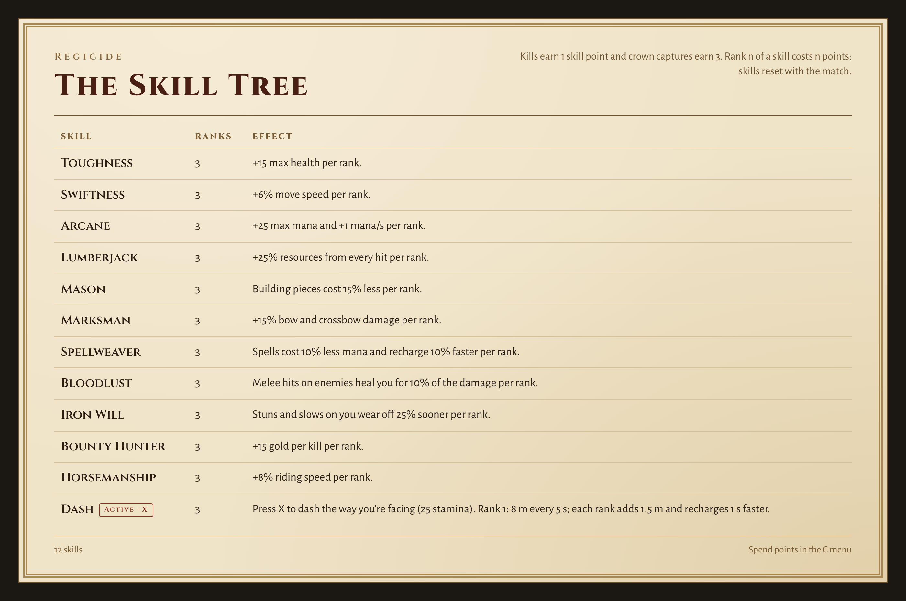

# Regicide

A medieval multiplayer arena battler built on **Godot 4.4**. Two teams of up to 50
spawn with nothing on a 400 × 720 m map of hills, forests and a winding river. They
gather wood, stone, iron and magic ore, build forts on a snap grid, craft weapons, and
fight to steal the enemy's crown and carry it back to their own. Siege engines, ladders,
drawbridges and battlements make attacking and defending a base a real fight.







## Spells and skills





## Running it

1. Install [Godot 4.4](https://godotengine.org/download) (standard build, not .NET).
2. Open the folder in Godot (`Import` → pick `project.godot`) and press **F5**.
3. **Host & Play**, or **Join** a host's IP. (**Test bots** fills empty slots with bots
   for solo testing; leave it at 0 for real matches.)

To test with several players on one machine: *Debug → Customize Run Instances*, enable
multiple instances, then host in one window and join `127.0.0.1` from the others.

Command line (arguments after `--`):

```sh
godot --headless --path . -- --server --port 24565          # dedicated server
godot --path . -- --host --bots 25                           # solo test vs bots
godot --path . -- --host --name Arthur                       # host and play
godot --path . -- --join 203.0.113.5 --port 24565 --name Bors
```

The default port is **24565** (UDP). Open it on the host's router to play over the internet.

## Controls

| Key | Action |
| --- | --- |
| WASD / Shift / Space | Move / sprint (uses stamina) / jump |
| X | Dash the way you're facing (needs the Dash skill; uses stamina) |
| Mouse | Look (first person; V toggles third person) |
| Left click | Swing, shoot, cast, gather, place a structure, or use an item (whatever is equipped) |
| Right click (hold) | Raise your shield to block; raise it just as a blow lands to parry |
| T (hold) / Y (hold) | Voice chat: nearby (positional) / your whole team |
| 1–9, 0, mouse wheel | Pick a hotbar slot |
| Q | Build mode; press again for the next page (walls → floors → siege → off) |
| R (build mode) | Rotate the piece |
| F / G (build mode) | Repair / upgrade-to-stone the piece you're aiming at |
| E | Lower/raise your drawbridge, fire your catapult |
| W / S on a ladder | Climb up / down |
| C (or B) | Crafting, blueprints, spells and skills |
| Tab (hold) | Scoreboard |
| Esc | Free the mouse |

## How a match works

- **Gather.** Hit trees and rocks. Fists get wood and stone slowly; an axe or pickaxe is
  faster, and a pickaxe is required for iron and magic ore. Magic ore only grows in the
  contested middle of the map.
- **Craft.** Tools, melee weapons, bows and arrows, and consumables cost resources (C menu).
- **Build.** Press Q. Pieces snap to a 4 m grid with 3 m levels and are paid for straight
  from your resources as you place them: wood/stone walls, half walls, window walls,
  arrow slits, battlements, team-only doors, drawbridges, floors, stairs, roofs, ladders,
  spike traps, ballistas, catapults and battering rams. Everything must connect to the
  ground (hillsides and riverbeds count): knock out the supports and it collapses.
  Repair damaged pieces (F) and upgrade wood to stone in place (G).
- **Siege.** Lean ladders on enemy walls and climb over, push a battering ram into their
  gate, or lob catapult boulders over the walls.
- **Terrain.** Hills, valleys, forests of full-size trees, and a river that slows you to a
  wade. Cross at the two fords, build a bridge, or lower a drawbridge across the narrows.
- **Earn gold.** Kills pay 50g; capturing a crown pays 250g to the carrier and 75g to
  every teammate; returning your own dropped crown pays 25g.
- **Unlock.** Spend gold on blueprints: war hammer, crossbow, ballista, spike trap,
  catapult, battering ram, horse saddle, health potion, and skillbooks.
- **Magic.** Learn spells with gold and magic ore — fireball, frost bolt (slows), chain
  lightning, heal aura, blink, earth wall, gust (knocks crowns loose), meteor, spectral
  warriors (summons 5 ghost knights), thunderclap (stun), siphon life, battle cry,
  shadow cloak (invisibility) and arcane ward — and cast them with mana. Mana regenerates;
  mana potions (brewed from magic ore) top it up.
- **Shields.** Craft a wooden or iron shield and hold right click to block hits from the
  front. Time it right as a sword lands to parry: no damage, and the attacker is stunned.
- **Skills.** Kills earn 1 skill point and captures 3. Spend them on Toughness,
  Swiftness, Arcane, Lumberjack, Mason (cheaper building), Marksman, Spellweaver
  (cheaper, faster spells), Bloodlust (melee hits heal you), Iron Will (shorter stuns),
  Bounty Hunter (more gold per kill), Horsemanship (faster riding) and Dash (press X
  to burst forward).
- **Voice chat.** Hold T to talk to everyone near you — positional 3D audio that fades
  with distance, enemies included — or Y for your whole team.
- **Steal the crown.** Touch the enemy crown to grab it. You move slower while carrying it,
  and drop it if you die. Bring it to your own pedestal **while your crown is home** to
  score. First to 3 captures wins, then a fresh match starts.
- **Bots are a testing tool.** Real matches are people. For solo testing, bots fill empty
  slots: they gather, craft, build wall rings, throw ladders on enemy walls, and attack.

## Project layout

```
autoload/      Net (connections, command line), Controls (input map), Sfx (synthesized sounds)
scenes/        main_menu, world, player (.tscn)
scripts/core/  Pure rules & data: GameData (all tuning/content), BuildGrid, Inventory, CrownRules, ...
scripts/game/  GameMode (server-authoritative match logic), BotBrain (test bots)
scripts/world/ World, map generator, resource nodes, structures, crowns
scripts/player Player controller
scripts/ui/    HUD, minimap, main menu
tests/         Unit tests, gameplay integration test, multiplayer smoke test
docs/          Design document and architecture notes
```

All items, costs and balance numbers live in `scripts/core/game_data.gd`.

## Tests

```sh
godot --headless --path . --import                         # first run only
godot --headless --path . res://tests/run_tests.tscn      # unit tests
godot --headless --path . res://tests/gameplay_test.tscn   # full rules on a live world
GODOT=godot tests/smoke.sh                                 # server w/ bots + 2 clients over ENet
godot --headless --path . --fixed-fps 60 res://tests/bot_soak.tscn -- --minutes 8 --bots 50
                                                           # full bot match, fast-forwarded
```

CI runs all four on every push (`.github/workflows/tests.yml`). The soak prints a
per-minute report (kills, steals, captures, structures, items, server frame time).

See [docs/DESIGN.md](docs/DESIGN.md) for the game design and roadmap, and
[docs/ARCHITECTURE.md](docs/ARCHITECTURE.md) for how the networking fits together.

## Credits

3D models are CC0 (public domain):

- The knight, his animations, swords, axe, bows and shields: KayKit Adventurers and
  KayKit Character Animations by [Kay Lousberg](https://www.kaylousberg.com)
- The horse: Farm Animals Animated by [Quaternius](https://quaternius.com)
- Castle pieces, camp tools, trees, rocks and plants: Castle Kit, Survival Kit and
  Nature Kit by [Kenney](https://kenney.nl)

Each pack's license is next to its models in `assets/`.
