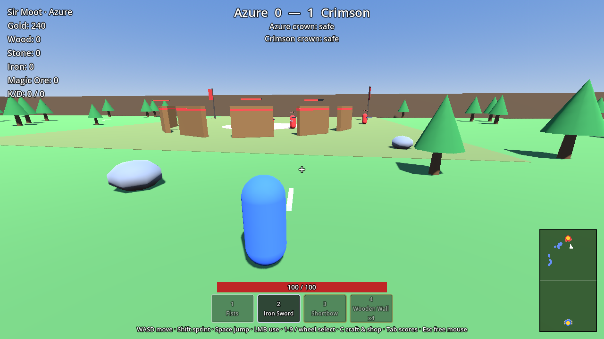

# Regicide

A medieval multiplayer arena battler built on **Godot 4.4**. Two teams of up to 50
spawn with nothing, gather wood, stone, iron and magic ore, build defenses, craft
weapons, and fight to steal the enemy's crown and carry it back to their own.
Empty slots are filled with bots, so a full 50v50 works with any number of humans.



## Running it

1. Install [Godot 4.4](https://godotengine.org/download) (standard build, not .NET).
2. Open the folder in Godot (`Import` → pick `project.godot`) and press **F5**.
3. Set **Team size** (bots fill the empty slots), then **Host & Play**, or **Join** a host's IP.

To test with several players on one machine: *Debug → Customize Run Instances*, enable
multiple instances, then host in one window and join `127.0.0.1` from the others.

Command line (arguments after `--`):

```sh
godot --headless --path . -- --server --port 24565 --bots 50 # dedicated server, full 50v50
godot --path . -- --host --name Arthur                       # host and play
godot --path . -- --join 203.0.113.5 --port 24565 --name Bors
```

The default port is **24565** (UDP). Open it on the host's router to play over the internet.

## Controls

| Key | Action |
| --- | --- |
| WASD / Shift / Space | Move / sprint / jump |
| Mouse | Look |
| Left click | Swing, shoot, gather, place a structure, or use an item (whatever is equipped) |
| 1–9, mouse wheel | Pick a hotbar slot |
| C (or B) | Crafting & blueprint shop |
| Tab (hold) | Scoreboard |
| Esc | Free the mouse |

## How a match works

- **Gather.** Hit trees and rocks. Fists get wood and stone slowly; an axe or pickaxe is
  faster, and a pickaxe is required for iron and magic ore. Magic ore only grows in the
  contested middle of the map.
- **Craft.** Tools, melee weapons, bows and arrows, walls, team-only gates, and
  consumables cost resources (C menu).
- **Earn gold.** Kills pay 50g; capturing a crown pays 250g to the carrier and 75g to
  every teammate; returning your own dropped crown pays 25g.
- **Unlock.** Spend gold on blueprints: war hammer, crossbow, ballista, spike trap,
  horse saddle, health potion, fireball scroll, and skillbooks.
- **Steal the crown.** Touch the enemy crown to grab it. You move slower while carrying it,
  and drop it if you die. Bring it to your own pedestal **while your crown is home** to
  score. First to 3 captures wins, then a fresh match starts.
- **Bots** gather, craft, buy upgrades, fortify their crown, attack in coordinated
  waves around the flanks, chase thieves, and escort their own carriers.

## Project layout

```
autoload/      Net (connections, command line), Controls (input map), Sfx (synthesized sounds)
scenes/        main_menu, world, player (.tscn)
scripts/core/  Pure rules & data: GameData (all tuning/content), Inventory, CrownRules, ...
scripts/game/  GameMode (server-authoritative match logic), BotBrain (AI)
scripts/world/ World, map generator, resource nodes, structures, crowns
scripts/player Player controller
scripts/ui/    HUD, minimap, main menu
tests/         Unit tests, gameplay integration test, multiplayer smoke test
docs/          Design document and architecture notes
```

All items, costs and balance numbers live in `scripts/core/game_data.gd`.

## Tests

```sh
godot --headless --path . --import                         # first run only
godot --headless --path . -s res://tests/run_tests.gd      # unit tests
godot --headless --path . res://tests/gameplay_test.tscn   # full rules on a live world
GODOT=godot tests/smoke.sh                                 # server w/ bots + 2 clients over ENet
godot --headless --path . --fixed-fps 60 res://tests/bot_soak.tscn -- --minutes 8 --bots 50
                                                           # full bot match, fast-forwarded
```

CI runs all four on every push (`.github/workflows/tests.yml`). The soak prints a
per-minute report (kills, steals, captures, structures, items, server frame time).

See [docs/DESIGN.md](docs/DESIGN.md) for the game design and roadmap, and
[docs/ARCHITECTURE.md](docs/ARCHITECTURE.md) for how the networking fits together.
